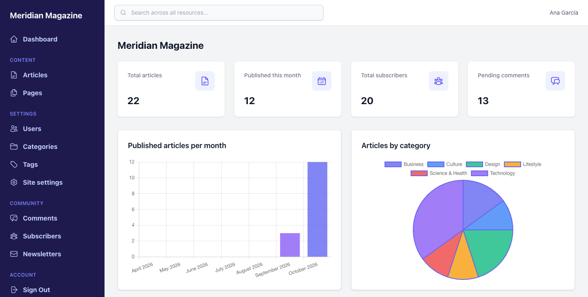

# IronAdmin

[](https://badge.fury.io/rb/iron_admin)
[](https://github.com/rubylab-app/iron_admin/actions/workflows/ci.yml)
[](https://github.com/rubocop/rubocop)

Convention-over-configuration admin panel engine for Ruby on Rails. Build beautiful admin interfaces with minimal code.

**[Live demo](https://demo.ironadmin.rubylab.app/)** · [Demo source](https://github.com/rubylab-app/meridian_magazine) · [Documentation](https://rubylab-app.github.io/iron_admin/)

[](https://demo.ironadmin.rubylab.app/)

The demo is Meridian Magazine, a Rails 8 app built with IronAdmin. Sign in as one of three
users (an admin, an editor or an author; no password needed) and see how resource policies
change what each role can do. Its [source](https://github.com/rubylab-app/meridian_magazine)
has the resources, dashboard, policies and theme behind it.

## Features

- **Zero Configuration CRUD** - Auto-generates forms and tables from your database schema
- **Resource DSL** - Customize fields, filters, scopes, and actions with a clean Ruby DSL
- **Dashboard Builder** - Create metrics, charts, and recent records widgets
- **Theme System** - Fully customizable Tailwind CSS classes for every UI element
- **Authorization** - Built-in policy system for fine-grained access control
- **Search** - Global search across all resources
- **Export** - CSV and JSON export out of the box

## Requirements

- Ruby >= 3.3 (tested on 3.3, 3.4, and 4.0)
- Rails >= 8.0.4 (tested on 8.0 and 8.1)
- [tailwindcss-rails](https://github.com/rails/tailwindcss-rails) >= 4.3
- The default `rails new` JavaScript setup: importmap with Stimulus. IronAdmin installs
  `importmap-rails` itself; its layout loads the admin JavaScript with
  `javascript_importmap_tags` and registers its Stimulus controllers on `window.Stimulus`,
  which `bin/rails stimulus:install` sets up.

## Installation

Add to your Gemfile:

```ruby
gem "iron_admin"
gem "tailwindcss-rails"
```

Then run:

```bash
bundle install
rails generate iron_admin:install
```

The install generator will:
- Create `app/iron_admin/resources/` and `app/iron_admin/dashboards/` directories
- Add a configuration initializer at `config/initializers/iron_admin.rb`
- Create a sample dashboard
- Mount the engine at `/admin` in your routes
- Add the IronAdmin Tailwind CSS import to your `app/assets/tailwind/application.css`

### Tailwind CSS Setup

IronAdmin uses Tailwind CSS v4 for all styling. The `tailwindcss-rails` gem handles
compilation. After running the install generator, your `app/assets/tailwind/application.css`
should include:

```css
@import "tailwindcss";
@import "../builds/tailwind/iron_admin";
```

The second line imports IronAdmin's `@source` directives so the Tailwind compiler
scans the engine's views and components for CSS classes. Without it, the admin panel
will render unstyled.

If you're setting up manually (without the generator), run:

```bash
rails tailwindcss:build
```

Then verify that `app/assets/builds/tailwind/iron_admin.css` was created. If not,
check that `tailwindcss-rails` >= 4.3 is installed (4.3 added the `tailwindcss:engines`
task that writes this file) and that the engine gem is properly loaded.

For development, use `bin/dev` or `rails tailwindcss:watch` to recompile CSS on changes.

## Quick Start

### 1. Configure Authentication

```ruby
# config/initializers/iron_admin.rb
IronAdmin.configure do |config|
  config.title = "My App Admin"

  config.authenticate do |controller|
    user = User.find_by(id: controller.session[:user_id])
    controller.redirect_to "/login" unless user&.admin?
  end

  config.current_user do |controller|
    User.find_by(id: controller.session[:user_id])
  end
end
```

### 2. Generate Resources

```bash
rails generate iron_admin:resource User
rails generate iron_admin:resource Product
rails generate iron_admin:resource Order
```

### 3. Customize Resources

```ruby
# app/iron_admin/resources/user_resource.rb
module IronAdmin
  module Resources
    class UserResource < IronAdmin::Resource
      field :role, type: :badge, colors: { admin: :purple, user: :blue }
      field :email, type: :text

      searchable :name, :email

      filter :role, type: :select, options: User.roles.keys
      filter :created_at, type: :date_range

      scope :admins, -> { where(role: :admin) }
      scope :recent, -> { where("created_at > ?", 7.days.ago) }

      index_fields :id, :name, :email, :role, :created_at
      form_fields :name, :email, :role

      menu priority: 1, icon: "users", group: "People"

      action :lock, icon: "lock-closed", confirm: true do |record|
        record.update!(locked_at: Time.current)
      end
    end
  end
end
```

### 4. Create a Dashboard

```ruby
# app/iron_admin/dashboards/admin_dashboard.rb
module IronAdmin
  module Dashboards
    class AdminDashboard < IronAdmin::Dashboard
      metric :total_users, format: :number do
        User.count
      end

      metric :monthly_revenue, format: :currency do
        Payment.where("created_at > ?", 30.days.ago).sum(:amount)
      end

      recent :users, limit: 5, scope: -> { order(created_at: :desc) }
      recent :payments, limit: 5
    end
  end
end
```

Visit `/admin` and your admin panel is ready!

## Documentation

Full documentation is available at https://rubylab-app.github.io/iron_admin/ and in the [docs](docs/) directory:

- [Installation](docs/getting-started/installation.md)
- [Quick Start](docs/getting-started/quick-start.md)
- [Resources Guide](docs/guides/resources.md)
- [Dashboard Guide](docs/guides/dashboard.md)
- [Theming Guide](docs/guides/theming.md)
- [Configuration Reference](docs/reference/configuration.md)
- [Upgrade Guide](UPGRADING.md)

## Development

After checking out the repo (use the Ruby in `.ruby-version`; IronAdmin needs Ruby >= 3.3):

```bash
bundle install
bundle exec rspec
bundle exec rubocop . .github/scripts
```

## Contributing

See [CONTRIBUTING.md](CONTRIBUTING.md) for details.

## License

The gem is available as open source under the terms of the [MIT License](MIT-LICENSE).
